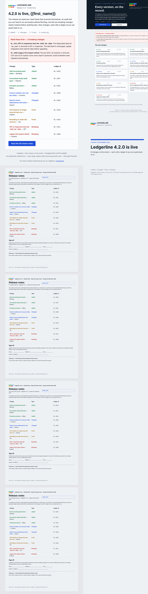
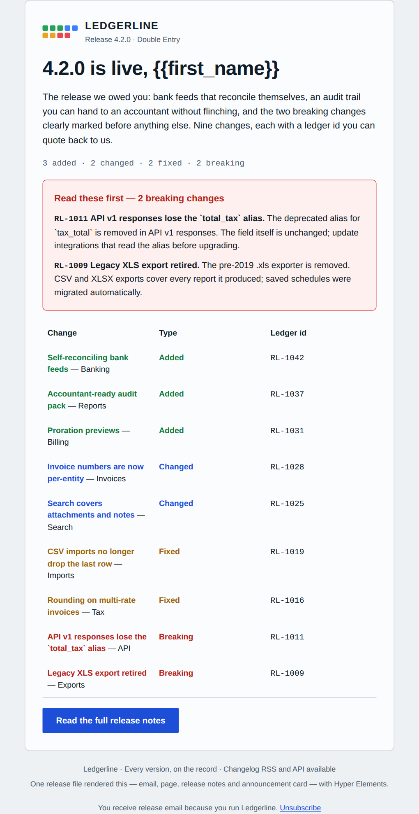
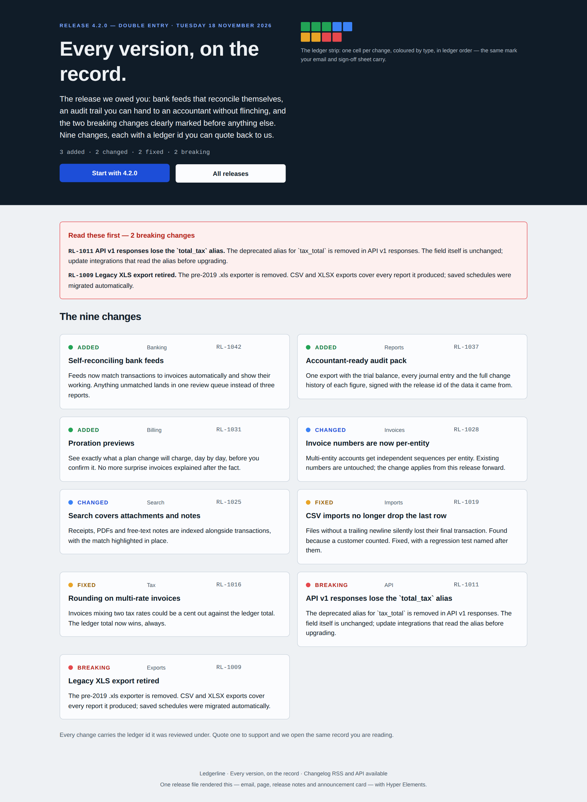
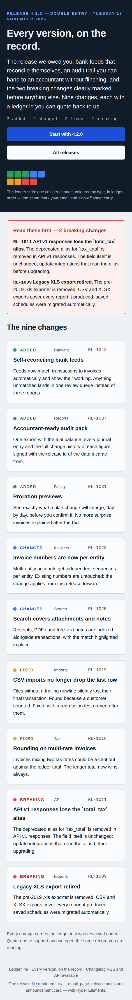
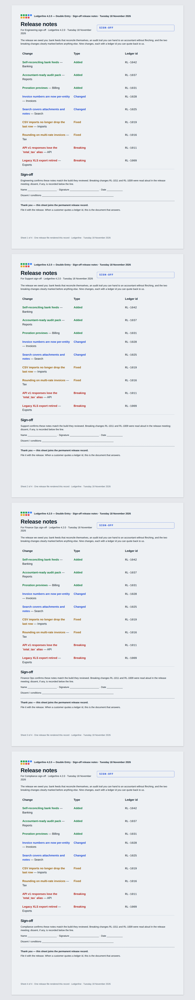
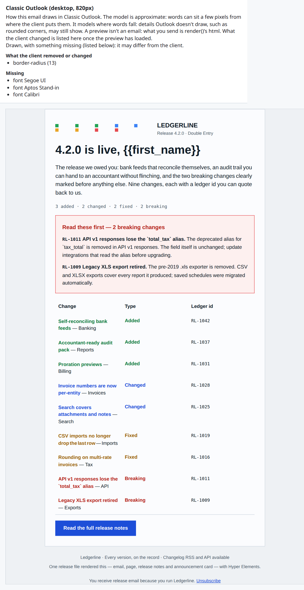
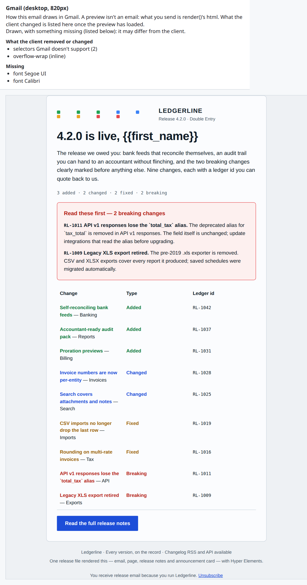

# RELEASE LEDGER — Every version, on the record

A Hyper Elements template kit for a software product's release day.
**One release file** (`src/data/release.ts`) renders everything a release
needs — the announcement email, the public release page, the sign-off
release notes as a real PDF, and the announcement cards — from **one
theme** and **one set of shared components**.



*Every screenshot in this README is a photograph of a real render
(`npm run render` + `npm run shots`): if it is pictured, it was rendered.*

**Measured on the demo run (18 Nov 2026):** one release file → **85
personalised announcement emails**, a **4-page sign-off PDF** (one sheet
per team), **4 announcement cards** (one per change type) — gate at
**0 errors, 0 warnings**, batch in **2.2s**. Reproduce it:
`npm run check && npm run make`, then read `out/checks.json` and
`out/batch.json`.

| The email (600px) | The page (desktop) | The page (mobile) |
|---|---|---|
|  |  |  |

| The sign-off notes (A4) | The email in Outlook | The email in Gmail |
|---|---|---|
|  |  |  |

The announcement card PNG itself is in
[`examples/announcement-card.png`](examples/announcement-card.png).

## Why a ledger?

Release notes fail in a predictable way: the email says one thing, the
website another, and the document legal signed says a third. This kit
makes that impossible by construction. Every change carries a **ledger
id** (`RL-1042`) assigned in the one release file; the email quotes it,
the page's cards carry it, and the sign-off sheet prints it next to the
signature line. The **LedgerStrip** — one cell per change, coloured by
type, in ledger order — is the release drawn as a mark, and it is built
from a `Grid` of `Column`s so it survives in an inbox that blocks images
and in a PDF that never loads one.

## The four outputs

| Output | Root | Script | What it is |
|---|---|---|---|
| Release email | `Email` → `render()` | `templates/release-email.tsx` | Breaking changes first, the full change table, a MergeTag greeting, plain-text twin from the same render |
| Release page | `Page` → `render()` | `templates/release-page.tsx` | Dark ledger hero, every change as a typed `ledger.ChangeEntry` card, no client-side JavaScript |
| Sign-off notes | `Document` → `renderPdf()` | `templates/release-notes-document.tsx` | One A4 sheet per signing team, header/footer with page numbers, name/signature/date lines, a dissent line |
| Announcement cards | `Canvas` → `renderImage()` | `templates/announcement-canvas.tsx` | 1080×1080 PNGs — one per change type, led by that type's colour and count |

## Run it

```bash
npm install
npm run check        # validate() gate: core + lint + email-clients -> out/checks.json
npm run render       # one of each output -> out/
npm run clients      # the email as Outlook / Gmail / Apple Mail draw it -> out/clients/
npm run make         # the batch: 85 emails + sign-off PDF + 4 cards
npm run make:sample  # same, 6 emails
npm run shots        # screenshots of the real renders -> docs/
npx hyper-elements check templates/   # 4 templates: 0 errors, 0 warnings, 0 skipped
```

Node 20+. The PDF and PNG steps take their fonts as files — see
`assets/fonts/README.md`. Without them the HTML still renders and the
scripts say exactly what is missing; nothing is ever fetched.

## How Hyper Elements is used

- **One `defineTheme()`** for all four roots: cool paper, slate ink,
  signal blue, sans + mono pairing, named `card` / `stamp` / `mono`
  styles, Button variants, per-format overrides. The theme carries no
  `mobile` blocks on purpose — phone styles are an error in a Document
  or a Canvas, so Email/Page templates set their own.
- **Shared components across roots** (`Wordmark`, `LedgerStrip`,
  `CountLine`, `ChangeTable`, `BreakingBlock`) — the emailed change and
  the signed change are the same change.
- **A custom element with `defineElement()`**: `ledger.ChangeEntry`,
  typed props via `prop.text` / `prop.choice`. A mistyped change type
  is a diagnostic with a path, before anything renders.
- **`validate()` as a gate**: the batch validates before writing a
  single file; `out/checks.json` makes the verdict an artefact.
- **`@hyper-elements/email-clients`** renders the email as the real
  clients draw it (screenshots in `docs/`).
- **Deterministic batch**: subscriber generation uses no clock and no
  randomness, so a corrections run re-renders only changed records.

## Structure

```
src/theme.ts                  the one theme
src/data/release.ts           the one release file (+ subscribers)
src/components/shared.tsx     components shared by all four outputs
src/components/change-entry.tsx  ledger.ChangeEntry (defineElement)
templates/                    one default-exported component per output
scripts/                      check / render / clients / make / shots
examples/                     one real artefact of each kind
docs/                         design notes, screenshots, judging scorecard
AGENTS.md                     ten invariants an agent must not break
```

## Data & privacy

All data is fictional sample data generated in this repository. No real
subscribers, no network calls, no credentials, no paid services.

## License

MIT — see `LICENSE`.
